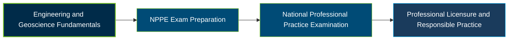

# APEGS National Professional Practice Examination (NPPE) Exam Guide

A dedicated study guide and professional practice reference for candidates preparing for the **National Professional Practice Examination (NPPE)**, used by Canadian engineering and geoscience regulators, including APEGS.

---

## Exam Overview

The National Professional Practice Examination (NPPE) assesses candidates' understanding of professionalism, ethics, professional practice, and the legal responsibilities associated with engineering and geoscience.

- **Exam Format**: Closed-book, remotely proctored computer-based examination with multiple-choice questions.
- **Target Audience**: Engineers-in-training, geoscientists-in-training, and eligible engineering or geoscience licensee applicants.
- **Prerequisites**: Eligibility is determined by the applicable provincial or territorial regulator. APEGS candidates must meet its registration and eligibility requirements.

---

## Core Exam Domains & Knowledge Areas

### 1. Professionalism

- Professional status, accountability, and responsibilities to society.
- Engineering and geoscience regulation, scope of practice, and public protection.
- The role and value of professional engineering and geoscience in Canada.

### 2. Ethics

- Ethical theories, principles, and professional codes of ethics.
- Conflicts of interest, confidentiality, and professional competence.
- Ethical dilemmas, whistleblowing, and responsible decision-making.

### 3. Professional Practice

- Professional accountability, workplace responsibilities, and client relationships.
- Risk management, insurance, quality management, and due diligence.
- Environmental responsibilities, communication, documentation, and software liability.

### 4. Law for Professional Practice

- Canadian legal system, contract law, tort law, and professional liability.
- Employment, business, intellectual property, and dispute resolution.
- Environmental law, occupational health and safety, human rights, and privacy.

### 5. Professional Law

- Provincial and territorial regulatory acts, regulations, and bylaws.
- Professional admission, licensure, scope of practice, and reserved titles.
- Illegal practice, enforcement, and professional or technical societies.

### 6. Regulation of Members & Discipline Processes

- Professional discipline procedures and complaint processes.
- Practice reviews of individual professionals and firms.
- Continuing professional development and regulatory responsibilities.

---

## Certification Path

---

## Recommended Practice & Study Resources

Prepare for the NPPE by reviewing the official examination blueprint, understanding professional obligations, and applying Canadian legal and ethical principles.

- **CertsGate**: Explore [NPPE exam preparation resources](https://certsgate.com/exams/apegs/nppe) for supplementary study materials and practice to help review professional ethics, engineering law, and regulatory concepts.
- **APEGS Professional Practice Resources**: Review [APEGS registration and NPPE guidance](https://www.apegs.ca/apply/how-to-apply/professional-practice-exam) to understand Saskatchewan-specific eligibility, application requirements, and professional responsibilities.
